# MiniPlayer for Browser Music

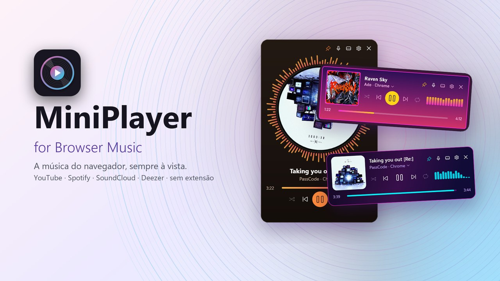

Mini player para Windows 11 que mostra e controla a música tocando no navegador
(YouTube, Spotify Web, SoundCloud, Deezer, ...). Sem extensão: lê os controles de mídia
do Windows (SMTC), onde Chrome, Edge, Firefox, Brave, Opera, Vivaldi, Arc, Zen e LibreWolf
publicam a Media Session.

<a href="https://get.microsoft.com/installer/download/9p1lq9m6qtj9?referrer=appbadge&cid=github" target="_self" >
	
</a>
<a href="https://github.com/williamanjo/MiniPlayer/releases/latest/download/MiniPlayer-win-Setup.exe">
	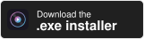
</a>

## Recursos
- Título, artista e navegador de origem
- Play/Pause, anterior, próxima, aleatório, repetir (lista → faixa → off)
- Barra de progresso clicável (seek)
- **Fixar no topo** (📌)
- **Redimensionar** o player flutuante pelas bordas/cantos; o layout se adapta:
  achatado vira uma linha só (mini), alto e estreito vira cartão com capa grande,
  estreito esconde itens secundários (tudo segue no clique direito).
  **Zoom**: Ctrl + roda do mouse (70%–200%); clique direito → "Redefinir tamanho" volta ao padrão
- **Encaixe** ao arrastar o player: acima da barra de tarefas, nas bordas da tela ou desligado
  (Configurações → Geral)
- **Modo barra de tarefas**: player compacto sobre a taskbar, ao lado da bandeja
  - arraste o texto para mover na horizontal; arraste as bordas para mudar a largura
  - clique direito → menu; clique duplo (fora dos botões) → volta ao modo flutuante
  - várias telas: arraste o player até a barra de tarefas de outra tela
    (requer "Mostrar barra de tarefas em todas as telas" no Windows)
  - some sozinho em tela cheia e com taskbar auto-ocultável escondida
  - cor do texto segue tema claro/escuro do Windows
- **Bandeja**: mostrar player, modo barra de tarefas, fixar no topo, temas, timer para dormir,
  histórico, configurações, atualizar (quando há versão nova) e sair
- Prioriza sessão de navegador tocando; troca automaticamente ao tocar em outra aba
- **Escolher aba/app**: clique no artista (▾) ou clique direito → "Tocando em"; "Automático" volta ao padrão
- **Volume**: roda do mouse sobre o player muda o volume só do app que toca (Mixer de Volume);
  clique do meio = mudo
- **Ocultar quando nada toca** (modo barra): some após 3 s sem mídia ou 30 s pausado
- **Letras sincronizadas** (botão 🎤 / "Mostrar letra na barra"): via [LRCLIB](https://lrclib.net).
  Desligado por padrão; quando ligado envia título/artista ao lrclib.net

- **Configurações** (⚙ no player ou na bandeja): Geral, Aparência (temas com prévia e editor),
  Atalhos e controles, Automação, Histórico, Transmissão (OBS), Barra de tarefas, Atualizações e Sobre.
  "Iniciar com o Windows" fica em Geral
- **Visualizador**: barras de áudio junto aos controles, sobre a capa, embaixo ou em volta da capa,
  e mini equalizador na barra de tarefas
- **Atalhos globais** configuráveis (padrão: `Ctrl+Alt+Home` play/pause, `Ctrl+Alt+←/→` faixa, `Ctrl+Alt+↑/↓` volume, `Ctrl+Alt+M` mudo, `Ctrl+Alt+P` mostrar/ocultar)
- **Timer para dormir**: minutos ou fim da música, com volume diminuindo aos poucos
- **Gestos**: roda do mouse = volume ou trocar música; clique do meio = mudo ou play/pause
- **Teclado no player** (com o player em foco): `Espaço` play/pause, `Ctrl+←/→` faixa anterior/próxima,
  `Ctrl+↑/↓` volume, `M` mudo; `Tab` percorre os botões. Os botões têm nome para leitores de tela

- **Automação**: pausa a música em ligações (microfone em uso) e abaixa quando outro app toca som

- **Histórico e estatísticas**: músicas ouvidas por dia (busca, copiar, buscar no YouTube/Spotify/Deezer) e mais ouvidos por período
- **Transmissão (OBS)**: arquivos "tocando agora" (texto, capa e overlay.html) atualizados a cada troca

- **Idiomas**: English, Português (Brasil), Español, Français, Deutsch, 日本語, Русский e 한국어, troca ao vivo em Configurações → Geral
  (padrão: idioma do Windows). Cada idioma é um arquivo em `Localization/Languages/<código>.json`

## Temas
11 temas embutidos: **Escuro**, **Claro**, **Vidro (capa)** (capa desfocada no fundo), **Neon**, **Vinil**
(capa redonda girando), **Terminal**, **Papel**, **Retrowave**, **Matcha**, **Aurora** e **Brutalista**.
Escolha em: bandeja → Temas, clique direito no player, ou Configurações → Aparência.

<table>
<tr><td align="center">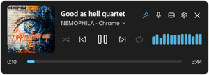<br/><b>Escuro</b></td><td align="center">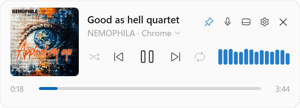<br/><b>Claro</b></td><td align="center">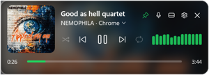<br/><b>Vidro (capa)</b></td></tr>
<tr><td align="center">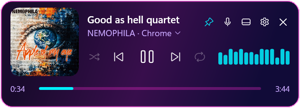<br/><b>Neon</b></td><td align="center">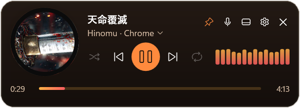<br/><b>Vinil</b></td><td align="center">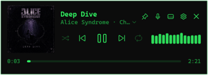<br/><b>Terminal</b></td></tr>
<tr><td align="center">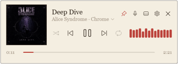<br/><b>Papel</b></td><td align="center">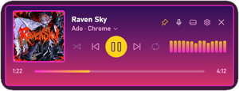<br/><b>Retrowave</b></td><td align="center">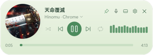<br/><b>Matcha</b></td></tr>
<tr><td align="center">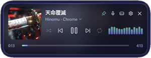<br/><b>Aurora</b></td><td align="center">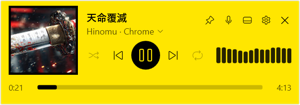<br/><b>Brutalista</b></td></tr>
</table>

### Criar um tema
O jeito mais fácil é o **editor de temas** (Configurações → Aparência), com prévia ao vivo.
Também dá para editar à mão: temas são arquivos `.json` em `%APPDATA%\MiniPlayer\themes` (ou numa pasta
`themes` ao lado do exe). A pasta já vem com `exemplo-oceano.json` comentado. Copie, mude `name` e as
cores — salvar recarrega na hora. Se o arquivo ficar inválido enquanto você edita, o player mostra o tema
padrão até você corrigir, sem perder a escolha.

| Campo | Exemplo | Descrição |
|---|---|---|
| `name`, `author` | `"Oceano"` | Nome no menu e autor |
| `background` | `"#F21F1F1F"` | Cor do fundo (`#AARRGGBB` aceita transparência) |
| `backgroundGradient` | `["#082032", "#137C8B"]` | Degradê diagonal (substitui `background`) |
| `border`, `borderThickness`, `cornerRadius` | `"#33FFFFFF"`, `1`, `10` | Borda e cantos |
| `foreground`, `secondaryForeground` | `"#FFFFFF"` | Texto principal e secundário |
| `accent`, `track`, `hover` | `"#60CDFF"` | Destaques, trilho do progresso, hover dos botões |
| `coverRadius` | `6` | Cantos da capa |
| `fontFamily` | `"Cascadia Mono"` | Fonte (precisa estar instalada) |
| `shadowOpacity` | `0.45` | Sombra (0 = sem) |
| `backdrop` | `"none"` / `"cover"` / `"image"` | Fundo: nada, capa desfocada, ou imagem |
| `backgroundImage` | `"fundo.png"` | Imagem na mesma pasta do tema (com `backdrop: "image"`) |
| `overlay` | `"#99000000"` | Película sobre capa/imagem p/ legibilidade |
| `authorPosition` | `"bottomRight"` | Crédito do autor: `bottom`, `bottomLeft`, `bottomRight`, `top`, `topLeft`, `topRight`, `cover` ou `none` |
| `backgroundAngle` | `90` | Direção do degradê em graus (0 = esquerda→direita, 90 = cima→baixo) |
| `backdropBlur`, `backgroundImageOpacity` | `30`, `1` | Desfoque da capa no fundo (0–80) e opacidade da imagem |
| `titleFont`, `titleSize`, `titleWeight`, `subtitleSize` | `"Georgia"`, `14`, `"bold"`, `12` | Título (`normal`, `semibold`, `bold`) e subtítulo |
| `lyricsColor`, `lyricsDimColor`, `iconColor` | `"#FFFFFF"` | Linha atual da letra, linhas vizinhas e ícones |
| `playButton`, `playButtonColor`, `playIconColor` | `"circle"` | Play/pause simples (`plain`) ou num círculo preenchido |
| `coverShape`, `coverSpin`, `coverSpinSeconds`, `coverSpinDirection` | `"circle"`, `true`, `12`, `"clockwise"` | Capa redonda girando (vinil); `counterclockwise` inverte |
| `coverBorder`, `coverBorderThickness`, `coverShadowOpacity` | `"#FF0B0B0B"`, `6`, `0.55` | Borda e sombra da capa |
| `progressGradient`, `progressHeight` | `["#FFB347", "#FF5E62"]`, `4` | Barra de progresso |
| `visualizerGradient`, `visualizerOpacity` | `["#FF5E62", "#FFB347"]`, `0.85` | Barras de áudio (de baixo para cima) |
| `shadowColor`, `shadowBlur`, `shadowDepth` | `"#000000"`, `14`, `2` | Sombra do player |

Temas são só dados (JSON, não XAML), então um tema de terceiros não executa código.
Arquivos inválidos aparecem com ⚠ no menu de temas.

## Instalação
Pela [Microsoft Store](https://apps.microsoft.com/detail/9p1lq9m6qtj9) (atualiza pela Store), ou baixe `MiniPlayer-win-Setup.exe` no [último release](https://github.com/williamanjo/MiniPlayer/releases/latest)
e execute. Instala na pasta do usuário (sem administrador), cria atalhos no Iniciar e na Área de Trabalho
e aparece em "Aplicativos instalados" para desinstalar. Não precisa de .NET instalado.

Pelo terminal, com o [winget](https://learn.microsoft.com/windows/package-manager/winget/) (instala a versão da Store):

```powershell
winget install 9P1LQ9M6QTJ9 -s msstore
```

Prefere sem instalar? Use `MiniPlayer-win-Portable.zip` (sem atualização automática).

### Atualizações
O app instalado verifica novas versões ao abrir e a cada 6 h. Quando há uma, mostra uma notificação do
Windows com **Atualizar agora** / **Depois** — ela fica na central de notificações mesmo com o app fechado,
e o botão abre o MiniPlayer e atualiza. Também há o item **⬆ Atualizar para vX** na bandeja.

**Manter atualizado** (Configurações → Atualizações): ao abrir, instala a nova versão sozinho; com o app aberto, só baixa
em segundo plano (sem reiniciar no meio da música) e instala na próxima abertura.

### Microsoft Store
A versão da Store é gerada pelo mesmo código com `-p:StoreBuild=true` e empacotada em MSIX
(`store/build-store.ps1`). A Store assina e atualiza o app.
Política de privacidade: [PRIVACY.md](PRIVACY.md).

## Build
Requer .NET 10 SDK e, para empacotar, `vpk` (`dotnet tool install -g vpk`).

```bash
dotnet build
```

```powershell
./release.ps1 -Version 1.2.0                          # gera instalador em ./releases
./release.ps1 -Version 1.2.0 -Notes notas.md -Upload  # publica release v1.2.0 no GitHub
```

Testar atualização sem publicar: gere duas versões numa pasta e rode o app instalado com
`MINIPLAYER_UPDATE_SOURCE=<pasta>`.

Configurações: `%APPDATA%\MiniPlayer\settings.json`. Na versão da Store o Windows guarda essa pasta em
`%LOCALAPPDATA%\Packages\<app>\LocalCache\Roaming\MiniPlayer` (Configurações → Sobre → "Abrir pasta de configurações" leva
até ela). Erros inesperados ficam em `error.log` na mesma pasta.

## Limitações
- **Uma aba por navegador**: Chrome/Edge/Firefox publicam só uma aba de mídia por vez. Se a aba publicada for pausada enquanto outra aba do mesmo navegador toca, o player avisa — dê pause/play na outra aba para ela assumir.
- **Aleatório/Repetir**: navegadores geralmente não expõem esses controles ao Windows,
  então os botões ficam desabilitados (cinza) para YouTube/Spotify Web etc. Funcionam
  com apps que suportam (ex.: Spotify desktop).
- Barra de progresso só aparece quando o site informa duração (Media Session `setPositionState`).
- Windows 11 não permite embutir janelas dentro da taskbar; o modo barra de tarefas é uma
  janela sempre-no-topo posicionada sobre ela (reafirma posição a cada 0,5 s).
  Taskbar vertical não é suportada nesse modo.
